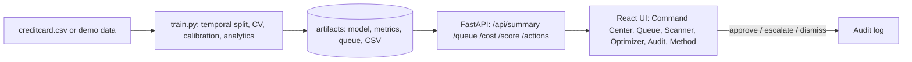

# FraudLens — Fraud Triage Command Center
**Powered by Genesis** · Maverick Skill Sprint · Project 5 (Fintech / Payments)

A card issuer processes ~300k transactions in two days and analysts can review **200 alerts per day**. FraudLens ranks every transaction so those 200 reviews catch as much fraud as possible, explains *why* each alert was raised, and recommends *what to do* — with a human approving every customer message.

> **Headline output (required by the brief):** a ranked top-200 queue, the sentence *"Of 200 alerts, ~X are real fraud; we catch ~Y% of all fraud"*, and a one-line analyst note per alert. All three are generated by `train.py`, shown in the app, and exported to `backend/artifacts/alert_queue_top200.csv`.

## Quick start (one command)
```bash
./start.sh        # macOS / Linux / Git-Bash      (Windows: start.bat)
# open http://localhost:8000
```

### Add your Gemini key (for the assistant)
Copy `.env.example` to `.env` and set `GEMINI_API_KEY=...` (get one at aistudio.google.com/apikey), then restart. The chat bubble is at the bottom-left of every screen. See `chatbot/README.md` for how to tweak it.

### Use the real Kaggle data  ⚠ do this before presenting
The package ships with artifacts trained on a **synthetic stand-in** (the UI shows an amber "Demo data" banner). To switch to the real dataset:
1. Download `creditcard.csv` from Kaggle (`mlg-ulb/creditcardfraud`) into `backend/data/`.
2. `cd backend && python train.py` (or just re-run `./start.sh`, which detects the file).
3. Run `python test_fraudlens.py`; the banner disappears and every number, chart and the headline sentence now reflect real data.

### Development mode
```bash
cd backend && pip install -r requirements.txt && python train.py && uvicorn app.main:app --reload --port 8000
cd frontend && npm install && npm run dev      # http://localhost:5173 (proxies /api to :8000)
```

## What's in the app
| Page | Purpose |
|---|---|
| **Command Center** | Hero statement, KPIs (fraud value intercepted, recall, precision, lift), threat capture curve, severity mix, hourly threat timeline, threat landscape (amount vs risk incl. missed fraud), precision–recall curve, attack-vector map, triage funnel, closest misses, model benchmark |
| **Alert Queue** | Search/filter the 200 alerts; side panel with signal fingerprint (radar), reasons, analyst note, approval-gated SMS, Approve / Escalate / Dismiss; CSV export |
| **Live Scanner** | Move signal sliders and see the verdict, rank, reasons and action update live |
| **Cost Optimizer** | Set cost of a missed fraud vs a false alarm and find the cheapest alert cutoff |
| **Audit Log** | Every analyst decision (who, when, what), exportable |
| **How it works** | Plain-English method, hackathon traps and our answers, live pipeline-integrity checks, glossary, roadmap |

One amber theme with **light and dark modes** (sun/moon button in the top bar, remembered per browser) is used across every page and chart. Red = threat, orange = high / missed, amber = accent and watch, green = clear.

## Method (short)
Temporal split (day 1 train → day 2 triage) · class weights, **no SMOTE** · scaler inside the pipeline · logistic regression vs gradient boosting chosen by time-ordered CV · ranking on raw log-odds (no ties) · Platt-calibrated risk (training-period out-of-fold only) · rank-based action tiers · PR-AUC and precision/recall @ 200 as headline metrics. See `docs/APPROACH_REVIEW.md` for the audit of the approach, what changed in v2.0 and the caveats to expect questions on.

## Architecture

Stack: Python, pandas, scikit-learn, FastAPI, Gemini API (assistant) · React 18, Vite, Recharts, lucide-react (fonts bundled, works offline). API docs: `http://localhost:8000/docs`.

## Tests
`cd backend && python test_fraudlens.py` — 14 checks: temporal split, scaler fit on train only, no label/ID features, queue integrity, headline matches queue, beats random, accuracy trap, no suspiciously perfect score, per-alert completeness, fraud-vs-normal example, integrity flags, analytics consistency, API endpoints, audit validation.

## Enterprise readiness — what's in, what's next
**In:** typed/validated API, health endpoint, audit trail with CSV export, human-in-the-loop messaging, reproducible training, automated tests, in-app Gemini assistant with saved chat history, offline-capable UI, accessible (keyboard, focus, ARIA) and responsive layout.
**Next (not built):** SSO / role-based access, immutable audit store, real-time scoring stream, drift monitoring and scheduled retraining, SHAP for the boosted model.

## Layout
```
backend/   train.py  test_fraudlens.py  app/{data,features,explain,main}.py  artifacts/  data/
frontend/  src/{App.jsx, styles.css, api.js, components/, pages/}   dist/ (prebuilt)
chatbot/   backend/ (Gemini client, history, prompts, router)  frontend/ (ChatWidget)  knowledge/*.md  test_chatbot.py
docs/      APPROACH_REVIEW.md  JURY_NOTES.md
.env       API keys and settings (copy from .env.example)
```
